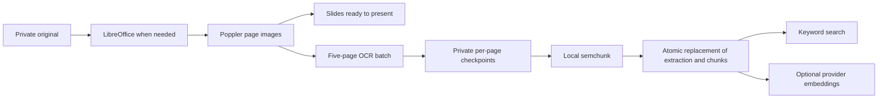

# AI workflow

**Maintained implementation reference, updated 2026-10-23.** Any change to AI processing, inputs, visibility, storage or user interactions must update this document in the same change. Confirmed decisions take precedence over older specification wording.

LectureLoop centres human questions and teaching. AI assists discovery, transcription and lecturer organisation. There is no chatbot, conversation memory, student profiling or autonomous question resolution.

## 1. Map of AI use

| Feature | Trigger | AI input | Output and consequence | User control |
| --- | --- | --- | --- | --- |
| Resource embeddings | Upload finishes, or lecturer rebuilds index | Extracted document text or imported transcript chunks | Search vectors in Postgres; source remains the original file | Exclude resource from search; retry indexing |
| Course search | Search words submitted | Query embedding plus authorised candidate passages/titles for semantic assessment | Grouped source/page/time links; explicit keyword fallback on failure | Open sources; retry incomplete search |
| Question preflight | Required retrieval after Post question | Query embedding and authorised candidate passages/titles | Semantically assessed sources; complete successful empty search posts the requested question automatically | Open sources, upvote; confirm posting when matches or failures exist |
| Optional generated answer | Question preflight, only when course setting enabled | Question and retrieved source excerpts/metadata | Short generated prose, shown separately from original sources | **Disabled by default**; course lecturer enables it |
| Live transcription | Lecturer starts microphone | PCM microphone stream, lecture title as vocabulary context | Captions, retained transcript windows, searchable lecture text | Explicit microphone permission, pause/stop; optional caption panel |
| Imported media transcription | MP3/MP4 processing | Converted 30-second WAV windows | Retained transcript and timestamped search sources | Retry processing; exclude resource from search |
| Teaching outline | Lecturer requests outline | Selected deck text | Optional list of topics for lecturer and topic context | Explicit request; not required to start teaching |
| Topic/checkpoint inference | Slide change or finalized speech enqueues job | Slide, recent speech, material extracts, optional outline, previous topic | Lecturer topic state; potentially opens/suggests poll under policy | Manual/suggested/auto/end-only policy; pause context; manual polls remain usable |
| Question equivalence grouping | New question or converted feedback | Question text and same-course/session candidates | Private lecturer grouping; no student cluster/count display | Lecturer can group, merge, split and resolve |
| Feedback classification/rewrite | Student explicitly sends named lecturer-only poll note | Original note | Verbatim feedback plus an optional clarified private question; cosmetic-only changes discarded | Original retained; lecturer can route note manually |
| Recording excerpt selection | Ended lecture, resolution, recording assembly or late transcript | Question and actual transcript candidates | Suggested playable passage, or unavailable state | Lecturer can correct/remove link; marked answered stays answered |

**Code entry points:** [question routes](../apps/api/app/questions.py), [retrieval](../apps/api/app/ai/retrieval.py), [intelligence](../apps/api/app/intelligence.py), [audio](../apps/api/app/audio.py), [ingestion](../apps/api/app/ingest.py), [worker](../apps/api/app/worker.py).

## 2. Provider boundary and information leaving the VM

All calls originate on the API/worker server. Browser code receives application results, never the OpenAI key. Provider protocols live in [contracts.py](../apps/api/app/ai/providers/contracts.py); the actual implementations are [openai.py](../apps/api/app/ai/providers/openai.py). Call sites instantiate the OpenAI adapters directly; replacing a provider currently requires wiring another implementation into those call sites, not just changing a dropdown.

| Environment setting | Code default | Interface used |
| --- | --- | --- |
| `OPENAI_TEXT_MODEL` | `gpt-4.1-mini` | Responses API, strict JSON schema, Pydantic validation |
| `OPENAI_EMBED_MODEL` | `text-embedding-3-small` | Embeddings API |
| `OPENAI_EMBED_DIMENSIONS` | `1536` | Vector dimensions checked against DB configuration |
| `OPENAI_LIVE_STT_MODEL` | `gpt-live-transcribe` | Server WebSocket transcription session, PCM 24 kHz |
| `OPENAI_BATCH_STT_MODEL` | `gpt-transcribe` | File transcription endpoint, returned text |
| `OPENAI_BASE_URL` | `https://api.openai.com/v1` | Configurable server endpoint |

These are code defaults, not a claim that every model is available to every account. Provider verification is recorded in [PROGRESS.md](PROGRESS.md). Model IDs remain configurable.

What leaves the server is the relevant text/audio listed in section 1. That includes private question text for lecturer-only equivalence and excerpt matching, and feedback text for classification. New feedback stores its sender for lecturers, but account identity is not added to classifier inputs. Historical anonymous questions retain no saved author identity; anonymity does **not** mean their text is never sent to the provider. Provider payloads do not intentionally include student account IDs or email addresses, but user-authored text can itself contain personal information. Retrieved source metadata may include internal source/course URLs and IDs.

The shared text adapter instructs the model to treat quoted course content as data, never instructions, and restricts output to a JSON schema. The text adapter refuses prompts above a local 16,000-token processing budget instead of silently truncating them. Callers budget complete source sections and balance sources before calling it. Search/preflight use the configured text model for bounded relevance assessment; no additional model service is introduced. Structured output is not proof that a judgment is correct. Local OCR processes document extraction images. The explicit optional diagram preparation flow additionally sends bounded slide images to provider vision (section 14).

Local storage and provider retention are different: the application stores the outputs described below, but does not maintain a separate local raw-provider-response history. The Responses request currently does **not** explicitly set `store: false`; provider-side storage/retention is not controlled by a local course deletion or the media volume. Account/provider retention policy and whether to change that request setting remain governed by the configured provider/account; this document does not promise provider-side erasure.

## 3. Local document extraction and chunking

The upload endpoint checks lecturer membership, file extension/content, size and course folder. Original bytes remain in the private persistent volume. Office files are converted to static PDFs by LibreOffice. Poppler `pdfinfo` inspects PDFs, and `pdftoppm` rasterizes them with crop boxes and page rotation applied. Page URLs retain their zero-based API index; user-facing PDF links use physical page numbers starting at one. Up to 500 pages are supported. Rendering readiness (`process_status`) is separate from text extraction (`extraction_status`) and indexing. Lecturers can present rendered slides while OCR continues; existing normalized slide annotations and PDF.js previews remain usable.

**OCR is local trained-model inference, not a provider or LLM call.** The worker runs PaddleOCR 3.7.0 **PP-StructureV3** through PaddleX 3.7.0's supported **ONNX Runtime 1.31.0 CPU backend**. It uses PP-OCRv5 mobile detection/recognition and PP-DocLayout_plus-L. Official PaddlePaddle ONNX artifacts are pinned by repository revision and SHA-256 in [ocr_models.json](../apps/api/app/ocr_models.json) and [ocr_checksums.json](../apps/api/app/ocr_checksums.json). The image provisions them under `/opt/lectureloop/models`; runtime processing does not fetch weights. The lean profile extracts text, heading labels, boxes and reading order. Dedicated table, formula, chart, seal, orientation-classification, unwarping and region-detection models are disabled. Poppler handles declared PDF rotation; arbitrary skew/photographs and complex mathematical/table structure remain limitations.

Each subprocess handles at most **five new pages**, with **two inference threads**, one recognition item at a time and one OCR batch globally (the single worker). OCR uses 150-DPI crop-box page images; presentation thumbnails retain approximately 1.3× scale. PaddleOCR's ordered blocks, labels, bounding boxes, page number, coordinate convention and model provenance are saved in private per-page JSON artifacts. Plain text joins ordered nonempty blocks with paragraph separators. Blank pages add no invented searchable text. Each page artifact is written atomically. Failed batches resume from saved artifacts; retries do not repeat completed pages. The subprocess releases inference memory after each batch. Graceful worker shutdown lets an in-flight batch finish and save its job state before exit. Recording assembly has queue priority before the next batch; OCR never preempts an already-running operation.

**Chunking is entirely local:** semchunk **4.1.1**, `chunking_model=None`, cached `cl100k_base` from tiktoken **0.12.0**, at most **512 tokens**, **64-token overlap**, exact character offsets. Its separator hierarchy prefers paragraph and sentence boundaries; oversized passages may still need splitting inside a paragraph. No API key, enrichment service or remote chunking model is used. Paragraph separators remain in stored source text. Each physical document page is split independently, so chunks cannot invent cross-page locations. The same splitter handles TXT/pretty-printed JSON and oversized transcript/forum content. TXT/JSON are source text sections, with **no artificial page numbers**. Audio chunks retain the original input-window times rather than estimating word/subchunk timings.

`Resource.pages` stores current usable page text/images and extraction-artifact references. `Resource.extraction_json` tracks target/completed extraction version, progress and chunking version. `SourceChunk.chunk_metadata` stores splitter version, original character offsets and source-section/transcript provenance. Plain chunk text and genuine embedding vectors are internal retrieval data. Embeddings are requested in batches of up to 32; mismatched model/dimension configurations are rejected. Missing keys leave genuine keyword-searchable chunks; no vectors are fabricated. Embedding failures can leave partial real embedding progress with full keyword search available.

**Backfill:** worker startup idempotently queues resources with older extraction/chunking versions, and older transcript/forum chunks. Current source files, exclusions, permissions and usable extraction/index remain intact while OCR checkpoints accumulate. Replacement page text and derived chunks are committed together only after every page and all local chunking succeed. Embeddings follow independently, so provider failure does not remove usable text. Failed jobs remain visible and require retry after the bounded automatic attempts. Lecturer Retry processing resumes saved OCR pages; Rebuild search index retries embeddings. Media and originals are never deleted by backfill.

**Source reading:** documents open in an authenticated PDF.js viewer, with page links, zoom and a rendered-page fallback. “Read page text” uses PDF.js on the displayed original page; it does not display retrieval chunks or invoke an LLM. Scanned PDFs may lack native PDF.js text even when OCR makes them searchable. TXT/JSON source text, media transcripts and forum threads remain readable in their source views. Search cards do not expose chunks. OCR reading order and recognition remain fallible; there is no claim of faithful table/formula reconstruction or automatic text correction.

Official references: [PP-StructureV3](https://www.paddleocr.ai/main/en/version3.x/pipeline_usage/PP-StructureV3.html), [inference engines](https://www.paddleocr.ai/main/en/version3.x/inference_deployment/local_inference/inference_engine.html), [semchunk](https://github.com/isaacus-dev/semchunk).

## 4. Search, required preflight and optional generated answers

Course search and question preflight use the same permission scope and source grouping in [retrieval.py](../apps/api/app/ai/retrieval.py), with separate query policies. Course membership is required. Current source filters enforce course isolation, enabled/ready resources, public discussions, including those moved out of the live queue and public replies. Private question/reply text never enters public search or optional grounded answers, even when the person searching is a lecturer. Public lecture speech can independently be retrieved without exposing the private student question that prompted it. Authorization is rechecked after provider latency. Public questions are also checked before indexing completes.

**Course Search and question preflight share semantic retrieval:** Search still asks for words, with no chatbot or generated-answer flow. Both paths embed the complete submitted query. Full-text/simple-token candidates, exact-title candidates, fresh public discussions and nearest permitted vectors provide recall. There is no minimum word-overlap/cosine gate that certifies meaning. Reciprocal candidate ranks combine lexical/semantic features; the text model then judges complete candidate passages as direct, useful, unrelated or uncertain. It must account for every supplied candidate ID and distinguish a passage match from a title-only match. Only direct judgments become source links; indirectly useful/supplementary material is excluded. Discussion candidates are explicitly identified: an unanswered question with the same teaching need is a direct similar-discussion match, independent of whether it contains an explanation. Reordered wording or missing question marks do not change this rule. Up to eight discussion passages reserve up to 3,000 tokens of the existing assessment budget, preventing document-heavy courses from crowding them out; the overall 32-passage/token limits remain. Concrete definitions may match an unspecified domain; explicit domain constraints must be respected. Technical acronyms, Unicode, mathematical symbols and programming-language distinctions are part of the semantic assessment; local tokenisation remains a lightweight candidate feature/fallback.

Candidate collection is bounded (up to 160 lexical and 160 nearest-vector candidates), with round-robin source allocation for at most 32 complete passages within a dynamic token budget (up to 10,000 source tokens). This is a defined retrieval procedure, not an exhaustive reading of every course document. Unknown/duplicate/missing assessment IDs, provider errors or deadlines trigger an explicit keyword fallback or failed preflight. The uncertainty alert appears only for a nonempty assessment in which **every** returned candidate decision is uncertain. Mixed uncertain/direct/useful/unrelated decisions do not produce this alert; uncertain candidates remain excluded from displayed matches. Zero candidates do not trigger uncertainty. Other readiness/indexing/provider warnings remain independent. A successful mixed assessment with no direct matches can therefore be a complete empty preflight when all other completeness checks pass. Resources, sources, authorship-independent public visibility and membership are rechecked after provider latency. Grouping's private question candidates never enter this public search scope.

**Completeness is explicit:** absent credentials, embedding/assessment failure, active ingestion/indexing, missing source embeddings, or fresh unindexed public discussions produce an incomplete/degraded warning. Pending private-question jobs do not affect learner-visible completeness or expose private activity. The method label reflects the completed path, rather than key presence. A complete empty preflight requires successful semantic stages and ready eligible content; keyword-only fallback never silently counts as a complete semantic check. An empty course can genuinely produce a complete empty result. No sources are invented.

**Internal hits versus public results:** internal hits retain chunk text for ranking and optional grounding. Public `matches` are typed source groups: stable parent ID, source kind, current title, primary URL, deduplicated page/time locations and best-hit score. Documents group by resource ID, recordings by imported-resource/live-session ID, and discussion replies by original question ID. A discussion title is the original question's opening text. The best qualifying hit ranks each group; the **eight-result limit applies after grouping**, so repeated chunks/pages cannot consume all results. TXT/JSON link directly to their source without fabricated pages. Ordinary course search returns sources only.

Course search and question preflight all display the same link-based cards: filename or thread title, physical page links or recording timestamp links, five locations initially and a control to reveal additional locations. There are no chunk excerpts or excerpt-expansion controls in these views. Original sources remain readable after following the links. Public-question upvoting is available once per thread/account and does not submit a new question. Transcript-only sessions are labelled as such and do not imply playable audio.

**Deadline budgets** (configurable server environment, maxima preserve a 30-second preflight):

| Setting | Default | Scope |
| --- | --- | --- |
| `RETRIEVAL_TIMEOUT_SECONDS` | 20 seconds | Complete source retrieval, including embedding |
| `QUERY_EMBEDDING_TIMEOUT_SECONDS` | 10 seconds | Query embedding within retrieval budget |
| `ANSWER_TIMEOUT_SECONDS` | 10 seconds | Optional generated answer after retrieval |

Search/preflight routes run in FastAPI’s thread pool; SQL/ranking uses a separate session in a worker thread; provider HTTP and coroutine deadlines are bounded, and PostgreSQL statement timeouts use remaining retrieval time. Provider failure retains genuine keyword results with a warning when possible. Full retrieval failure returns an explicit failed preflight. Semantic-search exceptions now emit a source-free `semantic_search_failed` JSON record in API server logs before fallback or deadline propagation. Records include a random search ID, internal course ID, mode/stage, elapsed and remaining milliseconds, candidate count, configured model names, exception category and file/function/line locations. Provider HTTP failures retain sanitized `x-request-id` and status; invalid decision coverage records expected/returned/missing/unexpected/duplicate counts; schema failures record an error count and bounded validator types/known schema-field locations (unknown field names are masked). No question/source/title text, embeddings, credentials, provider bodies, arbitrary exception messages, SQL parameters or Pydantic input values are logged. Keyword-fallback failure shares the same search ID. Both alerts remain visible in the UI; this owner revision changes the all-uncertain condition and adds diagnosis rather than hiding failures. See DEPLOYMENT.md for log retrieval. Background embedding/transcription/intelligence calls retain their independent adapter timeouts (normally 60 seconds for text/embedding and 120 seconds for file STT); worker leases/retries govern those jobs. OCR batches have a 600-second subprocess bound, with per-page rendering bounded at 120 seconds.

**Preflight interaction:** new questions are named and public within their course. The student chooses **Post question**, which runs retrieval first. A complete, warning-free result with zero matches automatically submits that question and shows a confirmation banner. Matches require explicit continuation (or opening/upvoting existing sources). Failure, degraded keyword fallback and optional-answer warnings require explicit **Post anyway**; they never automatically submit. A transport failure without a signed proof offers Retry source search, which must obtain a real proof before posting. Feedback uses a single **Send note to lecturer** action. It saves the exact original and queues classification immediately, without retrieval, query embedding, generation or a preflight proof. Feedback never publishes to the public forum automatically.

Editing question text clears the proof/results and assigns a fresh submission UUID. A signed ten-minute proof binds the course, exact text, session, purpose (`question` or `feedback`), submission ID when supplied, authenticated actor and failure state. It contains no raw text and is not persisted as a preflight row. The browser retains the proof and submission ID through posting errors. The backend serializes submissions per course and deduplicates by course/author/submission UUID; a repeated request returns its existing question even after the session ends, while changing the text/session with a reused ID is rejected. API clients omitting the optional submission UUID use a server-generated identifier in their proof, so retries with that proof also deduplicate. New request schemas reject anonymity/visibility options; internal legacy visibility remains enforced.

**Optional generated answer stays OFF by default.** If the course enables it, preflight sends the question plus bounded internal retrieved contexts to the text adapter. It must return `{answer, source_ids}` using IDs of returned parent sources; missing/unknown IDs discard the answer. Internal contexts use round-robin parent-source allocation within 6,000 tokens, so one long source cannot consume every slot. Returned prose is capped at 1,500 characters, separately labelled from the source links. There is no saved answer/query history or sentence-by-sentence citation map. Schema/citation validation does not prove every claim is supported. Generation failure preserves the source links and explicit posting controls.

## 5. Live and imported audio

**Live:** the [browser capture layer](../apps/web/src/AudioCapture.tsx) uses an abstract `AudioSource`, with a microphone implementation. AudioWorklet PCM16 mono is resampled to 24 kHz and forwarded to the authenticated lecturer audio WebSocket. The server owns the provider connection. The lecture title is the transcription prompt; course documents/private question queues are not added to that live STT prompt. Deterministic approximately five-second input commits are used; no server VAD is assumed.

Committed provider item IDs are mapped to checked input-window offsets on the session timeline. Partial and final caption events propagate to authorized course clients. Final text and item/window metadata are stored in `Transcript`; partial deltas are also persisted in `SessionEvent` by the event mechanism, so “partial” does not mean memory-only. No precise word timings are inferred. Final segments enqueue session indexing and topic inference. Captions are an optional student panel; the archived transcript is searchable.

Compressed recording uses a parallel MediaRecorder path with small checksummed durable uploads, separate capture groups, and saved start/end offsets. When recording was enabled with consent, FFmpeg assembles playable audio and aligns it with slide/annotation events. Microphone transcription can operate when recording retention is off; transcripts and caption events are still retained. A transcript-only search result must not imply captured audio exists. The current source-card label distinguishes lecture transcripts from recorded lecture sources.

**Imported MP3/MP4:** FFmpeg strips video for analysis and produces mono 24 kHz WAV windows of about 30 seconds. Extraction is marked ready only after the batch-STT pipeline finishes. Batch STT returns text; `Transcript` stores measured input-window offsets and `timing=input_window`. The original remains the playback source. No original slide alignment is assumed. Analysis WAV files remain in private storage; no automatic cleanup policy currently removes them.

**Failures:** microphone/provider failure is visible; slides, questions and manual polls remain operational. Missing recording has no pretend playback. Live recording assembly does not automatically run batch STT to repair a failed live transcript. Imported-file retries can reuse already saved transcript windows. These are separate workflows, not an implemented universal transcription repair pipeline.

## 6. Outline, topics and automatic polls

An explicit lecturer request enqueues `generate_outline`. Every nonempty extracted slide section is split locally and processed in batches of up to 5,000 source tokens. Per-batch topic outputs and physical page/section coverage are checkpointed in `Lecture.outline_json`, keyed by an input digest and processing version. Hierarchical reduction combines **all** partial outlines instead of clipping the beginning of a serialized deck. Empty pages are accounted for without invented topics. Failures retain partial coverage and retry resumes saved work. Status, processed-section counts and whether an older outline is still shown are visible to the lecturer. No generated outline is required to teach.

Topic inference uses balanced complete current-slide/recent-speech sections, plus semantically retrieved material from included course resources. It does not use a lexical >= 0.4 gate or arbitrary first-four matching resources. Supplementary material is limited by a source token budget; missing/partial context is recorded honestly. The configured text model interprets teaching continuity and checkpoints. It selects a stable reference (`previous`, an existing outline ID, or `new`); topic display-label changes alone do not trigger a poll. Unknown references are rejected, and state is rechecked under the session lock before writing.

For `auto`, an established previous topic, actual semantic transition, completed-explanation checkpoint and cooldown since start/transition/poll are required (default 180 seconds). `suggested` exposes a checkpoint flag; `manual` never opens topic polls. `end-only` remains a checkpoint on the last slide, once. Settings are copied at start; one-active-poll enforcement, pause, lifecycle and lecturer controls remain deterministic and independent of provider success.

## 7. Feedback transformation and question grouping

**Feedback:** the student writes a named lecturer-only note and chooses **Send note to lecturer**. The endpoint requires course membership, an active lecture and an open poll, but no preflight token or source check. It stores `Feedback.text_original` exactly and `author_id`, emits a lecturer-only update and queues asynchronous classification; provider failures do not block sending or reading the original. The classifier receives only note text, not the saved author identity.

**One LLM call per classification attempt:** the model partitions the entire original into ordered exact-quote segments marked request, feedback or uncertain. It identifies every independent explicit/implicit request, including statements such as “More detail on systems design would help,” and accounts for praise between requests. The same response carries a whole-note completeness self-check, per-request unchanged/clarified edit category and intent-preservation judgment. There is no second verifier call or question-cue regex. Local checks validate exact source provenance, ordering, nonoverlap and coverage of every word/technical symbol. Sentence separators left between exact quotes are accounted for locally and original punctuation is retained for unchanged requests. No request meaning is inferred from English keywords or punctuation.

Valid requests appear as separate paragraphs in one linked lecturer-only question, with structured `Question.request_parts` for later grouping/answer coverage. `Feedback.analysis_json` stores processing/model version, checked source offsets/kinds, request count and complete/original-retained status. Exact quotes need not be duplicated separately from the immutable original. Model self-assessment cannot guarantee completeness or correct classification; the simple quality fixtures exercise implicit/multiple requests and hard negatives.

If provenance/coverage/intent is invalid or uncertain, preserve the full original rather than an incomplete rewrite. A possible question stays in the private queue as the whole note; unclassified ambiguous feedback stays readable for lecturer routing. The panel explains retained-original status and offers explicit retry. Retry is another user-requested attempt, not an automatic second semantic pass. Provider failure still uses ordinary worker retries; the original remains readable throughout.

General feedback is never rewritten. The model keeps already-clear request wording and avoids cosmetic changes; local cheap comparison ignores only whitespace-equivalent text or a single added/removed terminal full stop. It preserves technical case, operators and punctuation. `AI edited` appears only for an accepted derived display change; original poll feedback stays verbatim without that badge or an Original feedback tag. New notes retain named sender attribution only for lecturers; historical missing identities stay missing. Rechecks update the same open, unedited, unmoved, not manually grouped/split derived question, preserving human edits/resolution. Migration 0013 remains historical and is not rerun or rewritten.

**Precision-first grouping:** eligible same-course/session questions are considered across the session, not only the latest eighty. Transient embeddings rank candidate groups; at most four complete candidate groups fit the model token budget. No cosine threshold alone establishes equivalence. One structured model judgment compares the new question with **every request of every member** of a proposed group. It must report certainty, exact checked-member/request IDs, no distinct teaching needs, and that one precise explanation satisfies the whole union. Related vocabulary, a broad combined answer or partial overlap is insufficient. Uncertain, incomplete, changed or oversized candidates remain separate. Groups over twelve members are left for manual organisation. These bounds favour false negatives over dangerous false merges; model certainty is not a calibrated probability.

Different quantities/cost assumptions (such as running time versus comparison count without shared premises) are treated conservatively as different teaching needs. Before applying a decision, the worker reloads and locks the session/questions and verifies full membership, text, request decomposition and manual/state flags. `Cluster.decision_json` retains model/version, checked IDs and the short decision reason for lecturer-domain provenance. Existing automatic groups are queued for whole-group review; until verified they cannot be bulk-answered. Rejected/uncertain legacy auto groups return to individual questions without changing human resolution. Manual groups are untouched. All member cards remain visible; automatic grouping never resolves or deletes a question. Manual groups and split suppression take priority. Candidate embeddings and model inputs can contain private question text within the lecturer domain; none enters public RAG or student cluster/count displays.

**Manual grouping and splitting:** Group questions reveals selection controls and help about automatic grouping. Save requires two distinct questions; Cancel/Escape clears selection. Split restores ordinary questions (`cluster_id=null`), with internal `auto_grouping_disabled` preserving the lecturer's decision. A lone remainder is detached. Explicit manual regrouping remains available. Author wording changes detach the edited question so stale equivalence cannot drive a bulk answer; manual split/group protections remain. Queue filters showing only one member return an individual projection, without bulk actions on hidden members. Lecturer resolve-group is still an immediate human action; recording matching is independent.

Migration 0015 adds only request/provenance fields with empty defaults; it does not reconstruct anonymous identities, publish private material, rewrite historical wording or rerun old migrations. Historical derived questions without checked request parts are assessed against their full original note when matching/grouping, so an older shortened display is not treated as proof of complete coverage.

## 8. Suggested recording excerpts and human resolution

**RAG finds course-wide sources on demand; recording matching saves a suggested association between one question and an actual passage from its lecture.** They share the same retained `Transcript` data, but have distinct scopes and lifecycles. RAG searches included course documents, teaching transcripts and public discussions for the current query and does not persist query-to-source associations. Recording matching runs as a background job for a specific question in its own ended lecture, and persists a correctable suggestion in `Question.match_json`. It can consider a private question inside the lecturer domain; that question does not thereby become a public RAG source. Neither retrieval nor a match changes human resolution state.

Marking a question/group answered is an immediate human state change. Independently of `match_json`, an answered session question exposes `recording_answer` for its whole lecture when recording is enabled and not failed/missing. The UI shows **Answered in [lecture title]** whenever no precise excerpt is available, including a removed/failed match. The URL opens the archive without a fabricated timestamp. While live or assembling it explains that the recording is not ready; a ready full recording is labelled as having no exact answer timestamp. Disabled, failed or empty recordings do not produce pretend playback links or a promise of a pending excerpt. A valid excerpt takes precedence. There is no start-answer/stop-answer control. An excerpt job runs against an ended session, waits for recording readiness and leaves the question's resolution unchanged throughout.

Transcript context is assembled **before** relevance selection: overlapping windows include neighbouring actual utterances, with up to a 5-second gap, 60-second span and 1,000-token target. An oversized single original segment is kept whole for budget handling, never given invented finer timestamps. Stored transcript embeddings are reused where available; missing window vectors are computed from real text. Per-request semantic/lexical ranks propose a diverse bounded set of up to twelve complete windows. There is no two-shared-word or lexical >= 0.25 rejection gate before the model.

One model call makes a **binary relevance decision** for every saved request: `direct` or `not_relevant`. A direct passage states, repeats, paraphrases or clearly implies the question and gives some response. Repeating the question followed by an answer is strong evidence. The model must not grade correctness, accuracy, depth or completeness; a brief, imperfect or incomplete answer can be relevant. A bare question, promise to answer later, or shared topic words without a response is not relevant. It selects short request/window/utterance aliases with no invented text/timestamps. Request IDs, window IDs and both utterance boundaries are constrained to finite enums in the provider response schema and validated again locally. The payload contains only aliases and ordered utterance text, never composite database IDs or nested transcript UUIDs. Boundaries must belong to the chosen window and occur in order. The single call chooses a tight question/response span (including an immediately repeated question), excluding unrelated lead-in/trailing chatter; the broader window supplies context only. Playback starts/ends at those actual captured utterance boundaries rather than the context-window boundaries. Transcript snapshots and human choices are rechecked after provider latency.

Any selected direct response saves a ready match, even if other requests have no relevant passage. Multiple actual response passages may be linked. There are no full/partial grades, completeness gate or partial lecturer-review workflow. For a lecturer-marked answered question, these links appear to authorized students as **Lecturer’s response** without a separate review/approval step. An open question's association remains lecturer-only until human resolution; the AI never marks it answered. If no passage is relevant, the human answered state remains intact and the full-recording answer link is used.

`Question.match_json` stores state, actual excerpt(s)/offsets/URLs, request IDs, binary relevance decisions/short reasons and model/version (`semantic-segment-response-v3`). Lecturers may still correct or remove a wrong association; those controls are optional corrections, not a publication gate. Background writes and failure handling preserve manually selected/removed links and human resolution. Startup queues eligible older failures/coverage-model associations with ready ended-session audio; a failed match job is retried in place with its attempt budget reset. Completed v2 direct/not-relevant decisions are retained without unsolicited bulk provider replay; an explicit lecturer recheck can refine their boundaries using v3. Old partial states project as pending until processed, not as a review task. Existing accepted links can remain usable during replacement. Unversioned ready links that may include older manual corrections are preserved for explicit recheck; their provenance notice concerns old data, not partial-answer quality. No migration or automatic publication of private questions occurs. Stored excerpts include only the selected contiguous utterances and their actual transcript IDs/times; per-request decisions retain resolved internal references for provenance. Error handling records a safe version/error code/type and preserves any existing ready/manual/removed association. Word-level alignment remains unimplemented; captured utterance/input-window precision is the limit.

## 9. Pictures and annotations

Profile pictures and course/lecture banners are separate local uploads, not course resources. They are **not sent to OCR, embeddings or any provider**, and are never added to RAG. Actual decoded JPEG/PNG/WebP files are limited to 5 MB and 20 million pixels, oriented from EXIF, resized (512px profile / 2048px banner bounds), stripped of embedded metadata and saved as WebP in the private media volume. Users manage only their own profile image; course lecturers manage banners; course membership gates banner reads. Profile image URLs mean the currently signed-in account and do not add identities to anonymous questions.

Live ink is a human-authored timestamped event, not AI output. New strokes use normalized slide-image coordinates; replay overlays track image bounds when resized or fullscreen. Existing events without a coordinate marker retain their legacy frame coordinates. Clear events erase prior ink on that slide at their saved time; rewinding before the clear restores it. Audio is replayed with synchronized visual overlays; annotation ink is not baked into an audio-only file. Missing timeline data is a visible retryable error.

## 10. Storage, deletion and failure summary

| Location | Saved information | Access / lifetime |
| --- | --- | --- |
| Private media volume | Originals, converted PDFs, page PNGs, versioned OCR block/checkpoint artifacts, analysis WAVs, recording chunks, assembled audio, signing key | Authenticated course endpoints; persistent across Compose restarts; file garbage collection is not automatic |
| `Resource.pages` | Current extracted page text/image/artifact paths or imported transcript windows; extraction progress/version in `extraction_json` | Course-scoped backend use; browser metadata does not expose raw storage paths |
| `SourceChunk` + embedding configuration | Internal search text, vectors/model, course/source IDs, page/time locators, splitter versions and character offsets | Public-safe retrieval scope checked against current source metadata |
| `Transcript`, `Recording`, `AudioChunk`, slide/annotation events | Final speech text, timing, protected playback and replay mapping | Course membership; recording retention governed by session consent; transcripts can exist without recording |
| `Question`, `Answer`, `Feedback`, `Cluster` | Original/display wording, visibility, human state, discussion-only flag, rewrite flags, grouping, suggested match | Private/mixed material lecturer-only; new questions/feedback named; legacy anonymous author ID NULL |
| `Lecture.outline_json`, `LiveSession.topic_json` | Optional outline and current topic/checkpoint state | Lecturer-facing; no complete topic revision history |
| `Job`, `SessionEvent` | Processing attempts/status/errors; durable event payloads including caption deltas/finals | Postgres; public event sequences exclude private activity; no automatic retention pruning |
| Browser memory | Current query, draft/submission UUID, preflight cards/proof and transient generated answer | Not a saved query/conversation history; in-memory state can be lost on refresh/navigation |
| Provider service | Request inputs and provider-managed response data | Outside local backups/deletion; see provider retention in section 2 |

A single Postgres-backed worker claims jobs with leases, renews them every 30 seconds and retries up to three times. Provider calls can take longer in background jobs than preflight's bounds. Failed jobs expose real errors; manual teaching remains available. Removing/excluding content takes effect in authorization/retrieval before any eventual cleanup. Course deletion removes database records, but orphaned media may remain inaccessible in private storage; neither that action nor question deletion promises provider-side erasure. Backups retain snapshots until the operator removes them.

Maintenance: update this document whenever triggers, models, extraction/chunking, provider payloads, storage, permissions, timeouts or AI-facing UI behaviour change. Verification evidence belongs in [PROGRESS.md](PROGRESS.md).

## 11. Human authorship and updates

Only a named author can edit a question or reply. Course lecturers can delete or dismiss others’ content and mark answers/groups resolved, but cannot rewrite another author’s words. New replies inherit thread visibility; historical private replies remain private. Session events signal question/reply changes and deletion with IDs only, filtered for private audiences. Visible course lists/open reply queries refresh every two seconds and invalidate immediately on relevant session events. Retrieval rechecks current parents/visibility, so removed content cannot remain a qualifying source while indexing catches up. One live session per course is enforced by course-row locking and a database partial unique index; AI does not control that limit.

## 12. Dismissal means move to discussions

The lecturer’s **Move to discussions** action sets `Question.discussion_only=true` and detaches its live cluster. Live snapshots and queues exclude it, while the persistent course forum and permitted retrieval retain it. Original session association, authorship, privacy, replies, votes, answered state and recording linkage remain intact. This is separate from actual Delete. Migration 0013 restores previously stored `dismissed` rows to discussions, recovering answered state only from persisted lecturer-answer events or written lecturer replies, otherwise leaving them open. It queues public records for reindexing; private notes remain lecturer-only. No deleted records are reconstructed.

## 13. Simple quality verification

A small authored `app/quality_cases.json` set covers synonymous definitions, technical acronyms/languages, mixed/implicit feedback and grouping hard negatives. `RUN_OPENAI_SMOKE=1 python -m app.quality_smoke` runs it against actual local Compose PostgreSQL/provider paths using disposable fixture accounts/course content, then removes only that exact fixture course. It prints pass/fail, latency and configured model/dataset versions; no credentials are printed. Deterministic pytest regressions cover privacy, timeouts, binary response relevance, source accounting and saved outline progress. This is a practical regression gate, not a claim of statistically calibrated production accuracy or a separate evaluation platform.

## 14. Optional interactive slide diagrams (0016)

This owner-promoted feature is preparation assistance, not a chatbot or a prerequisite for teaching. **Find interactive opportunities** explicitly queues `analyse_diagrams`; there is no automatic deck upload call. The worker inspects every rendered page in checkpointed batches of up to six images. It may return zero suggestions; there is no minimum or target count. Each suggestion has a validated zero-based slide index, title, learning benefit, proposed interaction, confidence category and rationale. Duplicate/out-of-batch indices fail validation. Suggestions never publish artifacts and do not themselves trigger code generation. Any slide can be generated manually, whether suggested or not.

`OpenAIVision.structured_images` is a separate multimodal provider interface, not an extension pretending the text interface accepts images. It sends actual private slide images as locally encoded JPEG data URLs (1280×960 bounds, quality 78, high image detail) and available text to the Responses API. Analysis sends at most six images / 6 MB encoded data and 5,000 characters of available text per page. Generation sends the target image and up to three nearby pages of text (6,000 characters each). Images remain primary evidence when OCR is incomplete; preparation displays this limitation. No invented text or fallback artifact is produced. The full prompt has a 12,000-token local cap. `OPENAI_DIAGRAM_MODEL` defaults to `gpt-4.1-mini`, independently configurable from text/embedding/STT; `DIAGRAM_TIMEOUT_SECONDS` defaults to 120, maximum 180 per call. Output limits are 6,000 tokens for analysis and 12,000 for generation, with incomplete/refused/malformed responses rejected. Multimodal requests explicitly set `store:false`; other existing adapters retain their previously documented storage behaviour. OpenAI documentation: [images](https://developers.openai.com/api/docs/guides/images-vision), [structured output](https://developers.openai.com/api/docs/guides/structured-outputs).

The generation prompt demands an accurate, concept-specific experiment, algorithm stepper, simulation or manipulable visual explanation with meaningful changing output. It asks for labelled touch/keyboard controls, responsive 320px layout, reduced motion, reset, brief instructions and a text alternative. Slides, OCR, refinement and earlier artifacts are untrusted data, never system instructions. Refinement includes the latest completed same-slide/same-pixel revision; complete prior code is included only within a 6,000-token budget, otherwise metadata explicitly describes the rebuild limit. This is one generation pass per attempt, not an automatic second verifier. A complete strict object contains `title`, `summary`, `instructions`, `accessibility_description`, `html`, `css`, `javascript`. The artifact is limited to 150 KB; fields have separate limits. HTML is parsed and reconstructed from an allowed element set, excluding links/forms/scripts/embeds/event attributes; URL CSS, external assets and known unsupported JS capabilities are rejected. These static checks are cheap compatibility safeguards, **not semantic interpretation or a security proof**. Rejected artifacts are not saved. Fixed, source-free artifact-validation reasons are recorded on the job and in worker logs (a blocked JS token/label is drawn only from fixed capability names), so an output rejection does not misleadingly imply unsupported model access. Unexpected/provider-schema exceptions remain redacted; generated code, slide text and raw provider bodies are never copied into job errors or logs. Ordinary bounded worker retries remain unchanged. The `top` guard distinguishes ordinary geometry/local-variable usage (such as `bounds.top`) from explicit global outer-frame access (`window.top`, `globalThis["top"]`, `top.location`); the prompt also prohibits outer-frame access. This does not turn lexical checks into a verifier or change the sandbox/CSP boundary. Preview execution catches ordinary runtime errors. Educational accuracy and usefulness require deliberate lecturer review; valid JSON/control presence does not certify either.

`diagram_analyses` saves source fingerprint, image fingerprints, completed-page checkpoint, suggestions, input note and job ID. `diagram_revisions` saves course/lecture/index, request UUID, pixel fingerprint, artifact, model, feedback, status and approval/publication provenance. Source/code stays in Postgres, never the static site directory or a student metadata response. There is no per-student progress record. Revisions progress through pending → preview → approved, with rejected/superseded/stale alternatives. Queue processing states/attempts/errors come from `processing_jobs`; three bounded automatic attempts use the existing backoff/heartbeat/lease mechanism. Analysis retry resumes completed batches; Generate/Regenerate creates another private revision. Repeated request UUIDs return the same result, and simultaneous identical active generation is coalesced. Errors are sanitized before storage so arbitrary provider validation text/code/slide contents cannot leak into jobs or logs. The main lecture remains available during every failure.

Every editor and final worker write locks the lecture row shared with session start. Model calls never hold this lock. Jobs recheck their attempt, current source and lecture state after provider latency. Starting freezes only already approved source-matching revisions via `published_at`; pending revisions become stale, and in-flight analysis/generation cannot publish or replace anything. Approval supersedes the old approved revision atomically under the lock and a partial unique index enforces one approved revision per lecture/slide. Regeneration alone leaves the earlier approval intact. Generation/approval/rejection/unpublication after any session start returns 409, including after ending. Image fingerprints hash decoded pixels and dimensions, with file-stat-keyed process caching; OCR-only text replacement does not invalidate a diagram. Pixel mismatch excludes published metadata and render access, requiring a newly reviewed experience before a new lecture. Pixel checks also run at approval/start/read, so an old diagram never silently follows a changed slide.

Only active course lecturers can inspect proposals, statuses, revisions or previews and issue preparation commands. Students cannot fetch unapproved/rejected/superseded source even by guessed IDs. Published metadata is restricted to the live active slide; direct student render access rechecks that active index too. Ended-session metadata permits every approved slide for archive replay. Removed/unjoined/cross-course users cannot read either. Source text and code are absent from lists/snapshots. On the live student view, each current approved diagram triggers a dismissible invitation once per classroom visit; Explore diagram explicitly opens the renderer, while Not now leaves a reopening button. No generated code runs merely because the invitation appears. Poll alerts take priority and activity invitations wait behind existing dialogs. No state is synchronized between viewers, and projection never contains this button. Lecturer/archive exploration stays manual. Replay selects by the computed historical slide index; its slide-timeline buttons work without a recording, and slide changes unmount stale iframe state.

The shared viewer uses an authenticated **HTML route** `/api/v1/diagrams/{id}/render?viewer=UUID`, not srcdoc/blob or parent HTML injection. Both iframe and HTTP CSP sandbox grant only `allow-scripts`, producing an opaque origin without cookie/DOM/storage access. The route requires same-origin iframe Fetch Metadata and current membership; top-level navigation is rejected. Caddy excludes only this exact route from its global CSP so it forwards **one** renderer policy: `default-src 'none'; script-src 'unsafe-inline'; style-src 'unsafe-inline'; img-src data:; connect-src 'none'; object-src 'none'; base-uri 'none'; form-action 'none'; frame-src 'none'; worker-src 'none'; media-src 'none'; frame-ancestors 'self'; sandbox allow-scripts`. Main-app script/framing restrictions remain intact. Responses use HTML UTF-8, no-store, nosniff, no-referrer and restrictive Permissions-Policy. No tokens or privileged app data enter the child. Trusted readiness/error/Escape notifications are the only messages; the parent validates opaque origin, exact frame source, message shape/type, artifact and random viewer instance. They grant no capability. The parent offers reset/close, a 15-second readiness timeout and 15-minute exploration lifetime, unmounts on error/slide change/close, and requires a running preview before its deliberate Approve and next action enables. The owner-approved workspace revision removes the extra checkbox. A compact original-slide reference expands inside preview.

**Remaining security/quality limits:** sandbox/CSP isolate capabilities, not CPU or memory. Arbitrary generated JS can hang its frame/browser renderer or render misleading content; a same-thread infinite loop can prevent UI timers from firing. Static checks can have false positives and can be evaded by obfuscated JS. Sandbox blocks parent navigation, forms, popups and downloads; CSP blocks network APIs/assets/subframes, but browsers do not universally implement a CSP prohibition on a child navigating its own frame. Links and known navigation APIs are rejected, but malicious self-navigation is a remaining browser-platform limitation, not a promised network/CPU jail. No original slide files, auth tokens or privileged app context are supplied to the child. Lecturer approval is educational review, not execution trust. Provider/model quality and real mobile-device/browser differences still require practical review. There is no new service, CDN, external renderer, analytics or persistent student interaction state.

## 15. Integrated preparation and responsive diagram layout — 2026-10-23

Lecturer preparation is now a slide workspace: thumbnail rail with unselected-by-default checkboxes, Suggested/Waiting/Generating/Ready to review/Approved/Needs attention indicators, source slide + Diagram tabs, contextual suggestion/actions and compact revision history.

Clicking Generate interactive diagram, Generate replacement/retry, or Generate selected first opens a small optional Teaching notes dialog (1,500 characters). Blank is valid; opening/cancelling never queues work. Only Generate preview(s) submits. Notes can describe a teaching focus, example or desired interaction; batch notes apply to each selected slide, as disclosed in the dialog. The existing `feedback` request/revision field stores these initial notes and later refinement, remains lecturer-only in preparation metadata, and is supplied to the model as `lecturer_guidance` alongside the actual slide and nearby text. The generation prompt explicitly treats guidance as untrusted preferences that cannot override execution/layout rules. No additional model call is introduced. Unacknowledged/failed submission retries prefill their notes and keep the request UUID when notes are unchanged; changed notes use a fresh UUID.

Generate selected explicitly submits each chosen slide through the existing generation endpoint; each request keeps a stable UUID across an unacknowledged transport retry, successful submissions are removed from selection, failures stay individually retriable, and identical active work remains server-deduplicated. There is no new batch endpoint, database migration, automatic generation or provider call on browsing. Immediate submission feedback bridges the HTTP request to durable job status; analysis reports actual completed/total pages, generation reports queued/processing rather than invented percentages/ETAs. Background completions update badges and the ready list without opening anything. The existing start action stays prominent with approved/unfinished counts and remains independent of preparation status.

Review ready previews is explicit and follows slide order. Approve and next enables after the isolated frame runs and advances through that selected ready list; Reject and next advances without approval. Neither action auto-approves other slides. There is no review checkbox. Refinement is entered inside review, supplies the existing prior-artifact context, and leaves the current version open while a replacement queues. The lecturer explicitly chooses Review replacement when ready. Existing approvals remain in force until replacement approval. Source changes/membership loss remove stale previews; per-slide status, original-slide expansion, retry/reset, errors and readonly post-start controls remain available as appropriate.

The isolated `DiagramFrame` owns nonce-instance/source/origin-checked notifications, loading timeout, runtime-error handling and lifetime, separately from layout. The shared viewer fills the laptop viewport with a compact header, dominant canvas and narrow instructions/review sidebar. The desktop stage itself does not scroll; the contextual sidebar scrolls only when it has excess content. On phones, the stage comes first and context follows in a single scrollable dialog body. The embedded setup Diagram tab uses the same frame. Reset remounts its local state; changing slides or closing still tears down generated JS. Sandbox/CSP/authentication and publication rules are unchanged.

**New generation layout convention:** the existing artifact HTML/CSS/JS fields are retained. Generation must return one balanced `div#ll-diagram[data-layout="responsive-v2"]` with direct `section[data-region="visual"]` and `section[data-region="controls"]` regions. Static validation checks one root, both regions, balanced markup and operable controls in the controls region; absence rejects the generation rather than declaring readiness. This is structural layout validation, not proof of educational quality or complete browser fit. The trusted server wrapper recognizes this marker, gives the root the full iframe viewport, and supplies a laptop grid with a broad visual plus side controls, stacking regions below 700px, with compact direct button rows and a reserved visual area on phones. It removes root/body narrow-width constraints for this convention only and allows genuine excess content to scroll within its region. It never crops content or scales all text down to disguise overflow. The prompt requires the visual to resize to both available width and height (SVG viewBox or Canvas ResizeObserver), no phone-width desktop stage, no repeated introductory headings, and operability at 1280×720, 1440×900 and phone widths. No second model call or new provider is introduced.

Earlier artifacts do not acquire the new convention or have their source rewritten. They receive the roomier host viewer but retain their existing document layout; hardcoded narrow internal layouts require deliberate regeneration before teaching. Already published content remains fixed. Browser tests measure actual iframe width/height and document overflow at the required desktop/mobile viewports, operate controls, retain opaque-origin/CSP checks and exercise review progression. A separate opt-in authored-source real-provider journey checks actual generated responsiveness and replay. Remaining untrusted-JS, model accuracy, CPU and navigation limitations from section 14 still apply.

### Student activity announcements — 2026-10-24

The student classroom automatically presents each unanswered open poll in a dismissible voting popup and each current approved diagram as an invitation to explore. This is deterministic frontend delivery of existing server-authorized activities, not a new AI trigger or provider call. A per-mounted-view seen set prevents repeat alerts during snapshot refresh/reconnect; manual reopening remains possible. Poll response storage, named lecturer-only feedback, diagram approval/frozen session scope, renderer authentication/sandbox and manual teaching controls are unchanged. Invitations queue behind other dialogs, polls take priority, and stale/ended activities close. Browser Back/Escape dismiss. A full reload starts a new visit; already-answered polls are not automatically prompted.

### Note submission confirmation — 2026-10-24

Sending a poll note is a one-time POST of the exact submitted text, without retrieval or waiting for AI classification. On success the composer clears and collapses, returning focus to its summary. A confirmation outside the collapsed form remains visible: “Note sent.” The sent record is not an editable draft. Newly entered text creates a separate feedback record and classification job. Only an in-flight send shows pending/wait state; empty input is disabled with a normal cursor. Duplicate submits are blocked while pending. Failure retains the draft for explicit retry. Sender attribution, lecturer-only visibility and existing classification behavior are unchanged.

Diagram reopening refinement (2026-10-24): the automatic first-time activity invitation still offers Explore diagram / Not now. The persistent Explore interactive diagram button under the live slide opens the authenticated sandboxed viewer directly in one click, including after dismissal or a prior exploration; it does not repeat the invitation. Choosing this button counts as noticing the activity. Browser Back/Escape, focus restoration and stale-slide cleanup remain in effect. No generation, approval, provider input or sandbox permission changes.
