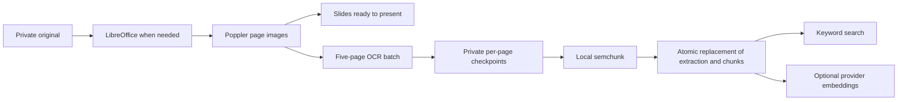

# AI workflow

**Maintained implementation reference, updated 2026-10-23.** Any change to AI processing, inputs, visibility, storage or user interactions must update this document in the same change. Confirmed decisions take precedence over older specification wording.

LectureLoop centres human questions and teaching. AI assists discovery, transcription and lecturer organisation. There is no chatbot, conversation memory, student profiling or autonomous question resolution.

## 1. Map of AI use

| Feature | Trigger | AI input | Output and consequence | User control |
| --- | --- | --- | --- | --- |
| Resource embeddings | Upload finishes, or lecturer rebuilds index | Extracted document text or imported transcript chunks | Search vectors in Postgres; source remains the original file | Exclude resource from search; retry indexing |
| Course keyword search | Search words submitted | Local keyword tokens/stems; no provider input | Sources matching all significant words, grouped with page/time links | Open sources; use fewer words to broaden |
| Question preflight | Required retrieval after Post question | Question text sent for embedding | Hybrid-ranked permitted sources; successful empty question search posts the requested question automatically | Open sources, upvote; confirm posting when matches or failures exist |
| Optional generated answer | Question preflight, only when course setting enabled | Question and retrieved source excerpts/metadata | Short generated prose, shown separately from original sources | **Disabled by default**; course lecturer enables it |
| Live transcription | Lecturer starts microphone | PCM microphone stream, lecture title as vocabulary context | Captions, retained transcript windows, searchable lecture text | Explicit microphone permission, pause/stop; optional caption panel |
| Imported media transcription | MP3/MP4 processing | Converted 30-second WAV windows | Retained transcript and timestamped search sources | Retry processing; exclude resource from search |
| Teaching outline | Lecturer requests outline | Selected deck text | Optional list of topics for lecturer and topic context | Explicit request; not required to start teaching |
| Topic/checkpoint inference | Slide change or finalized speech enqueues job | Slide, recent speech, material extracts, optional outline, previous topic | Lecturer topic state; potentially opens/suggests poll under policy | Manual/suggested/auto/end-only policy; pause context; manual polls remain usable |
| Question equivalence grouping | New question or converted feedback | Question text and same-course/session candidates | Private lecturer grouping; no student cluster/count display | Lecturer can group, merge, split and resolve |
| Feedback classification/rewrite | Student explicitly sends named lecturer-only poll note | Original note | Verbatim feedback plus an optional clarified private question; cosmetic-only changes discarded | Original retained; lecturer can route note manually |
| Recording excerpt selection | Ended lecture, resolution, recording assembly or late transcript | Question and actual transcript candidates | Suggested playable passage, or unavailable state | Lecturer can correct/remove link; marked answered stays answered |

**Code entry points:** [question routes](../apps/api/app/questions.py), [retrieval](../apps/api/app/ai/retrieval.py), [intelligence](../apps/api/app/intelligence.py), [audio](../apps/api/app/audio.py), [ingestion](../apps/api/app/ingest.py), [worker](../apps/api/app/worker.py).

## 2. Provider boundary and information leaving the VM

All calls originate on the API/worker server. Browser code receives application results, never the OpenAI key. Provider protocols live in [contracts.py](../apps/api/app/ai/providers/contracts.py); the actual implementations are [openai.py](../apps/api/app/ai/providers/openai.py). Call sites instantiate the OpenAI adapters directly; replacing a provider currently requires wiring another implementation into those call sites, not just changing a dropdown.

| Environment setting | Code default | Interface used |
| --- | --- | --- |
| `OPENAI_TEXT_MODEL` | `gpt-4.1-mini` | Responses API, strict JSON schema, Pydantic validation |
| `OPENAI_EMBED_MODEL` | `text-embedding-3-small` | Embeddings API |
| `OPENAI_EMBED_DIMENSIONS` | `1536` | Vector dimensions checked against DB configuration |
| `OPENAI_LIVE_STT_MODEL` | `gpt-live-transcribe` | Server WebSocket transcription session, PCM 24 kHz |
| `OPENAI_BATCH_STT_MODEL` | `gpt-transcribe` | File transcription endpoint, returned text |
| `OPENAI_BASE_URL` | `https://api.openai.com/v1` | Configurable server endpoint |

These are code defaults, not a claim that every model is available to every account. Provider verification is recorded in [PROGRESS.md](PROGRESS.md). Model IDs remain configurable.

What leaves the server is the relevant text/audio listed in section 1. That includes private question text for lecturer-only equivalence and excerpt matching, and feedback text for classification. New feedback stores its sender for lecturers, but account identity is not added to classifier inputs. Historical anonymous questions retain no saved author identity; anonymity does **not** mean their text is never sent to the provider. Provider payloads do not intentionally include student account IDs or email addresses, but user-authored text can itself contain personal information. Retrieved source metadata may include internal source/course URLs and IDs.

The shared text adapter instructs the model to treat quoted course content as data, never instructions, and restricts output to a JSON schema. Prompt text is capped at 50,000 characters. This is a mitigation, not proof that model judgments are correct. There is no separate safety/reranker model or provider-side document vision analysis; the local OCR models described below process document images.

Local storage and provider retention are different: the application stores the outputs described below, but does not maintain a separate local raw-provider-response history. The Responses request currently does **not** explicitly set `store: false`; provider-side storage/retention is not controlled by a local course deletion or the media volume. Account/provider retention policy and whether to change that request setting remain governed by the configured provider/account; this document does not promise provider-side erasure.

## 3. Local document extraction and chunking

The upload endpoint checks lecturer membership, file extension/content, size and course folder. Original bytes remain in the private persistent volume. Office files are converted to static PDFs by LibreOffice. Poppler `pdfinfo` inspects PDFs, and `pdftoppm` rasterizes them with crop boxes and page rotation applied. Page URLs retain their zero-based API index; user-facing PDF links use physical page numbers starting at one. Up to 500 pages are supported. Rendering readiness (`process_status`) is separate from text extraction (`extraction_status`) and indexing. Lecturers can present rendered slides while OCR continues; existing normalized slide annotations and PDF.js previews remain usable.

**OCR is local trained-model inference, not a provider or LLM call.** The worker runs PaddleOCR 3.7.0 **PP-StructureV3** through PaddleX 3.7.0's supported **ONNX Runtime 1.31.0 CPU backend**. It uses PP-OCRv5 mobile detection/recognition and PP-DocLayout_plus-L. Official PaddlePaddle ONNX artifacts are pinned by repository revision and SHA-256 in [ocr_models.json](../apps/api/app/ocr_models.json) and [ocr_checksums.json](../apps/api/app/ocr_checksums.json). The image provisions them under `/opt/lectureloop/models`; runtime processing does not fetch weights. The lean profile extracts text, heading labels, boxes and reading order. Dedicated table, formula, chart, seal, orientation-classification, unwarping and region-detection models are disabled. Poppler handles declared PDF rotation; arbitrary skew/photographs and complex mathematical/table structure remain limitations.

Each subprocess handles at most **five new pages**, with **two inference threads**, one recognition item at a time and one OCR batch globally (the single worker). OCR uses 150-DPI crop-box page images; presentation thumbnails retain approximately 1.3× scale. PaddleOCR's ordered blocks, labels, bounding boxes, page number, coordinate convention and model provenance are saved in private per-page JSON artifacts. Plain text joins ordered nonempty blocks with paragraph separators. Blank pages add no invented searchable text. Each page artifact is written atomically. Failed batches resume from saved artifacts; retries do not repeat completed pages. The subprocess releases inference memory after each batch. Graceful worker shutdown lets an in-flight batch finish and save its job state before exit. Recording assembly has queue priority before the next batch; OCR never preempts an already-running operation.

**Chunking is entirely local:** semchunk **4.1.1**, `chunking_model=None`, cached `cl100k_base` from tiktoken **0.12.0**, at most **512 tokens**, **64-token overlap**, exact character offsets. Its separator hierarchy prefers paragraph and sentence boundaries; oversized passages may still need splitting inside a paragraph. No API key, enrichment service or remote chunking model is used. Paragraph separators remain in stored source text. Each physical document page is split independently, so chunks cannot invent cross-page locations. The same splitter handles TXT/pretty-printed JSON and oversized transcript/forum content. TXT/JSON are source text sections, with **no artificial page numbers**. Audio chunks retain the original input-window times rather than estimating word/subchunk timings.

`Resource.pages` stores current usable page text/images and extraction-artifact references. `Resource.extraction_json` tracks target/completed extraction version, progress and chunking version. `SourceChunk.chunk_metadata` stores splitter version, original character offsets and source-section/transcript provenance. Plain chunk text and genuine embedding vectors are internal retrieval data. Embeddings are requested in batches of up to 32; mismatched model/dimension configurations are rejected. Missing keys leave genuine keyword-searchable chunks; no vectors are fabricated. Embedding failures can leave partial real embedding progress with full keyword search available.

**Backfill:** worker startup idempotently queues resources with older extraction/chunking versions, and older transcript/forum chunks. Current source files, exclusions, permissions and usable extraction/index remain intact while OCR checkpoints accumulate. Replacement page text and derived chunks are committed together only after every page and all local chunking succeed. Embeddings follow independently, so provider failure does not remove usable text. Failed jobs remain visible and require retry after the bounded automatic attempts. Lecturer Retry processing resumes saved OCR pages; Rebuild search index retries embeddings. Media and originals are never deleted by backfill.

**Source reading:** documents open in an authenticated PDF.js viewer, with page links, zoom and a rendered-page fallback. “Read page text” uses PDF.js on the displayed original page; it does not display retrieval chunks or invoke an LLM. Scanned PDFs may lack native PDF.js text even when OCR makes them searchable. TXT/JSON source text, media transcripts and forum threads remain readable in their source views. Search cards do not expose chunks. OCR reading order and recognition remain fallible; there is no claim of faithful table/formula reconstruction or automatic text correction.

Official references: [PP-StructureV3](https://www.paddleocr.ai/main/en/version3.x/pipeline_usage/PP-StructureV3.html), [inference engines](https://www.paddleocr.ai/main/en/version3.x/inference_deployment/local_inference/inference_engine.html), [semchunk](https://github.com/isaacus-dev/semchunk).

## 4. Search, required preflight and optional generated answers

Course search and question preflight use the same permission scope and source grouping in [retrieval.py](../apps/api/app/ai/retrieval.py), with separate query policies. Course membership is required. Current source filters enforce course isolation, enabled/ready resources, public discussions, including those moved out of the live queue and public replies. Private question/reply text never enters public search or optional grounded answers, even when the person searching is a lecturer. Public lecture speech can independently be retrieved without exposing the private student question that prompted it. Authorization is rechecked after provider latency. Public questions are also checked before indexing completes.

**Course Search is keyword-based:** the field asks for “Search words”, with an example such as “binary search”. One-word queries and short technical terms such as AI, ML and C++ work. Unicode/case normalization and local Snowball English stemming (snowballstemmer 3.1.1, bounded cache, one stemmer per thread) match inflections such as sorting/sorted and recursion/recursive. No OpenAI query embedding or answer generation is requested for course search. Every significant keyword must occur in the same passage or in the current parent title. Multiword body matches must fit within an 80-word span to avoid unrelated paragraphs qualifying through scattered words. Exact phrases, closer terms and title matches rank higher; there is no semantic-only qualification. Title-only matches link to the whole source and do not invent page/time locations. Postgres FTS narrows body candidates; Python applies the final all-word/proximity gate. Source grouping and the eight-parent cap apply afterward. These are precision-focused engineering rules, not calibrated probabilities. Stemming is English; arbitrary spelling errors and cross-language synonym expansion are not promised. Missing a strong match produces an honest empty result, not a vague substitute.

**Question preflight uses hybrid retrieval:** Postgres English full-text candidates (any significant query term, so natural questions and OCR punctuation do not require every term to match) and query-embedding cosine candidates pass the existing relevance gates: lexical score at least 0.45 with two shared significant words, **or** cosine similarity at least 0.78. Rank is `0.60 × lexical + 0.35 × nonnegative similarity + 0.05 × capped full-text rank`. Immediate public-question fallback requires lexical score at least 0.6. These are engineering heuristics, not probabilities or a declaration that a question is answered. There is no LLM reranker.

**Internal hits versus public results:** internal hits retain chunk text for ranking and optional grounding. Public `matches` are typed source groups: stable parent ID, source kind, current title, primary URL, deduplicated page/time locations and best-hit score. Documents group by resource ID, recordings by imported-resource/live-session ID, and discussion replies by original question ID. A discussion title is the original question's opening text. The best qualifying hit ranks each group; the **eight-result limit applies after grouping**, so repeated chunks/pages cannot consume all results. TXT/JSON link directly to their source without fabricated pages. Ordinary course search returns sources only.

Course search and question preflight all display the same link-based cards: filename or thread title, physical page links or recording timestamp links, five locations initially and a control to reveal additional locations. There are no chunk excerpts or excerpt-expansion controls in these views. Original sources remain readable after following the links. Public-question upvoting is available once per thread/account and does not submit a new question. Transcript-only sessions are labelled as such and do not imply playable audio.

**Deadline budgets** (configurable server environment, maxima preserve a 30-second preflight):

| Setting | Default | Scope |
| --- | --- | --- |
| `RETRIEVAL_TIMEOUT_SECONDS` | 20 seconds | Complete source retrieval, including embedding |
| `QUERY_EMBEDDING_TIMEOUT_SECONDS` | 10 seconds | Query embedding within retrieval budget |
| `ANSWER_TIMEOUT_SECONDS` | 10 seconds | Optional generated answer after retrieval |

Search/preflight routes run in FastAPI’s thread pool; SQL/ranking uses a separate session in a worker thread; provider HTTP and coroutine deadlines are bounded, and PostgreSQL statement timeouts use remaining retrieval time. Provider failure retains genuine keyword results with a warning when possible. Full retrieval failure returns an explicit failed preflight. Background embedding/transcription/intelligence calls retain their independent adapter timeouts (normally 60 seconds for text/embedding and 120 seconds for file STT); worker leases/retries govern those jobs. OCR batches have a 600-second subprocess bound, with per-page rendering bounded at 120 seconds.

**Preflight interaction:** new questions are named and public within their course. The student chooses **Post question**, which runs retrieval first. A complete, warning-free result with zero matches automatically submits that question and shows a confirmation banner. Matches require explicit continuation (or opening/upvoting existing sources). Failure, degraded keyword fallback and optional-answer warnings require explicit **Post anyway**; they never automatically submit. A transport failure without a signed proof offers Retry source search, which must obtain a real proof before posting. Feedback uses a single **Send note to lecturer** action. It saves the exact original and queues classification immediately, without retrieval, query embedding, generation or a preflight proof. Feedback never publishes to the public forum automatically.

Editing question text clears the proof/results and assigns a fresh submission UUID. A signed ten-minute proof binds the course, exact text, session, purpose (`question` or `feedback`), submission ID when supplied, authenticated actor and failure state. It contains no raw text and is not persisted as a preflight row. The browser retains the proof and submission ID through posting errors. The backend serializes submissions per course and deduplicates by course/author/submission UUID; a repeated request returns its existing question even after the session ends, while changing the text/session with a reused ID is rejected. API clients omitting the optional submission UUID use a server-generated identifier in their proof, so retries with that proof also deduplicate. New request schemas reject anonymity/visibility options; internal legacy visibility remains enforced.

**Optional generated answer stays OFF by default.** If the course enables it, preflight sends the question plus bounded internal retrieved contexts to the text adapter. It must return `{answer, source_ids}` using IDs of returned parent sources; missing/unknown IDs discard the answer. Returned prose is capped at 1,500 characters, separately labelled from the source links. There is no saved answer/query history or sentence-by-sentence citation map. Schema/citation validation does not prove every claim is supported. Generation failure preserves the source links and explicit posting controls.

## 5. Live and imported audio

**Live:** the [browser capture layer](../apps/web/src/AudioCapture.tsx) uses an abstract `AudioSource`, with a microphone implementation. AudioWorklet PCM16 mono is resampled to 24 kHz and forwarded to the authenticated lecturer audio WebSocket. The server owns the provider connection. The lecture title is the transcription prompt; course documents/private question queues are not added to that live STT prompt. Deterministic approximately five-second input commits are used; no server VAD is assumed.

Committed provider item IDs are mapped to checked input-window offsets on the session timeline. Partial and final caption events propagate to authorized course clients. Final text and item/window metadata are stored in `Transcript`; partial deltas are also persisted in `SessionEvent` by the event mechanism, so “partial” does not mean memory-only. No precise word timings are inferred. Final segments enqueue session indexing and topic inference. Captions are an optional student panel; the archived transcript is searchable.

Compressed recording uses a parallel MediaRecorder path with small checksummed durable uploads, separate capture groups, and saved start/end offsets. When recording was enabled with consent, FFmpeg assembles playable audio and aligns it with slide/annotation events. Microphone transcription can operate when recording retention is off; transcripts and caption events are still retained. A transcript-only search result must not imply captured audio exists. The current source-card label distinguishes lecture transcripts from recorded lecture sources.

**Imported MP3/MP4:** FFmpeg strips video for analysis and produces mono 24 kHz WAV windows of about 30 seconds. Extraction is marked ready only after the batch-STT pipeline finishes. Batch STT returns text; `Transcript` stores measured input-window offsets and `timing=input_window`. The original remains the playback source. No original slide alignment is assumed. Analysis WAV files remain in private storage; no automatic cleanup policy currently removes them.

**Failures:** microphone/provider failure is visible; slides, questions and manual polls remain operational. Missing recording has no pretend playback. Live recording assembly does not automatically run batch STT to repair a failed live transcript. Imported-file retries can reuse already saved transcript windows. These are separate workflows, not an implemented universal transcription repair pipeline.

## 6. Outline, topics and automatic polls

An explicit lecturer outline request enqueues `generate_outline`. It sends up to 30,000 characters of serialized selected-deck page text to the text adapter and saves `{topics: [...]}` in `Lecture.outline_json`. No generated outline is necessary to create/start the lecture.

A slide change or finalized transcript enqueues `infer_topic`. The job skips ended/paused sessions and inference less than 20 seconds after the previous inference. Context is the current slide (up to 6,000 characters), the last twelve finalized speech windows, up to four material extracts (1,000 characters each, selected by lexical overlap from up to thirty ready/included resources), the optional outline and previous topic name. This is a bounded lexical context collection, not a separate vector RAG call.

The model returns topic, subtopic, transition, checkpoint and brief reason. `LiveSession.topic_json` stores current state, timestamps and suggestion/error flags; it overwrites current topic state rather than building a full historical topic table. Events announce updates only to lecturers. The UI does not show a topic confidence percentage.

For `auto`, the code requires an established previous topic, a different inferred topic, a completed-explanation checkpoint and cooldown since start/transition/poll (default 180 seconds). `suggested` exposes a checkpoint flag. `manual` does not open topic polls. Current `end-only` means a detected checkpoint on the **last slide**, once, rather than an unconditional end-session poll. Course poll settings are copied at session start. A new poll supersedes the previous one, while the database enforces at most one open poll. Lecturer manual controls do not depend on successful inference.

## 7. Feedback transformation and question grouping

**Feedback:** the student writes a named lecturer-only note and chooses **Send note to lecturer**. The endpoint requires course membership, an active lecture and an open poll, but no preflight token or source check. It stores `Feedback.text_original` exactly and `author_id`, emits a lecturer-only update and queues asynchronous classification; provider failures do not block sending or reading the original. The classifier receives only note text, not the saved author identity.

The prompt distinguishes praise, opinions, pacing and general feedback from actual questions. It reads the entire note and extracts **every** distinct question or request for explanation, including imperatives and later questions mixed with praise. Structured output contains a classification and an ordered `requests` list; each request has an exact contiguous `source_quote` and a lightly clarified `question`. For example, a note asking for more about irradiance and asking what systems design means must retain both requests. They appear as separate paragraphs in **one** linked private queue entry, rather than creating duplicate feedback or separate threads.

Locally, source quotes must occur in the original order without overlap. Missing/invalid quotes, empty question text, an explicit question/request cue left outside the quotes, or oversized output cause the **whole original note** to be used in the private queue. This conservative guard prevents obvious omissions; it is not a semantic completeness proof, and implicit or non-English requests may still require lecturer review. Quote spans are transient validation data and are not stored separately or indexed. The existing `Feedback` original/rewrite fields and linked private `Question` retain the accepted result. Repeated classification updates that same question only while it is open, unedited, not moved to discussions and not manually grouped; human wording, resolution and moderation take priority.

The backend never rewrites general feedback. For a question, it accepts a light clarification only if the normalized word sequence changes; punctuation-only, case-only and whitespace-only changes are discarded. `text_rewritten` is NULL and `ai_modified=false` when no substantive question rewrite is accepted. A private question preserves both original and accepted display text plus sender attribution. It stays lecturer-only. Original feedback always appears verbatim under **Poll feedback & AI processing**, with its author and routing status, without the redundant “Original feedback” tag or an AI-edited badge for that original. A meaningful rewrite and its AI-edited label appear only on the private question card, where the original is inspectable. A lecturer can manually route a note without waiting for successful classification. Historical anonymous feedback stays anonymous. Sending, privacy and provider timeout behaviour are unchanged.

Migration 0013 clears historical general-feedback rewrites and cosmetic-only question rewrites while preserving originals. A linked private question is corrected only if its display still equals that cosmetic rewrite and it has not been human-edited. No provider call or reclassification is needed for this repair.

**Grouping:** for a new open question, take up to eighty recent open questions from the same course **and same session** (or course forum context). Embed those texts, consider the top three with cosine similarity at least 0.70, then ask whether the exact same answer would satisfy both questions. Store a `Cluster` and question cluster assignments; the canonical text is an existing candidate question, not an invented teaching answer. These comparison embeddings are transient call results, separate from persistent retrieval vectors. Manually maintained clusters are not overwritten by automatic grouping. Questions moved out of the live queue are detached from live clusters and excluded from further automatic live grouping.

Private and public questions may be compared only within the lecturer domain. Students see ordinary visibility-filtered questions, never mixed cluster metadata/counts. Lecturer resolve-group marks underlying questions answered immediately and queues matching separately. Grouping failure does not prevent posting or manual organisation.

Manual selection is opt-in: **Group questions** reveals the checkboxes and an explanation that AI already groups related questions automatically. The same explanation is available from the button's hover tooltip and accessible description. Select at least two questions to save; Cancel or Escape clears the selection, and successful saving exits selection mode. Hidden/deleted questions are excluded from the submitted selection. Manual grouping continues to use the existing permission-checked endpoint; no new provider request is introduced by entering selection mode.

**Splitting restores individual questions:** selected questions have no cluster membership; a lone remainder also becomes an individual. A group requires at least two distinct members. Internal `Question.auto_grouping_disabled` preserves the lecturer's split decision without creating one-question manual clusters. Automatic grouping skips these questions both as inputs and comparison candidates; explicit manual regrouping is still available. Provider results recheck current wording, state, membership and manual decisions under the session lock before writing, so an in-flight result cannot undo a split. Splitting does not change wording, author, privacy, human resolution or recording links, and emits only a lecturer-audience grouping event. Migration 0014 dissolves old singleton/empty clusters, retaining manual suppression on their former members. Deletion, movement and manual reassignment also dissolve a lone remainder. If a queue filter shows only one member of a genuine larger group, its response has `id=null` and the UI shows ordinary individual actions; it does not offer a bulk action on hidden questions. No new AI model, prompt, timeout or external data is introduced by this correction.

## 8. Suggested recording excerpts and human resolution

**RAG finds course-wide sources on demand; recording matching saves a suggested association between one question and an actual passage from its lecture.** They share the same retained `Transcript` data, but have distinct scopes and lifecycles. RAG searches included course documents, teaching transcripts and public discussions for the current query and does not persist query-to-source associations. Recording matching runs as a background job for a specific question in its own ended lecture, and persists a correctable suggestion in `Question.match_json`. It can consider a private question inside the lecturer domain; that question does not thereby become a public RAG source. Neither retrieval nor a match changes human resolution state.

Marking a question/group answered is an immediate human state change. Independently of `match_json`, an answered session question exposes `recording_answer` for its whole lecture when recording is enabled and not failed/missing. The UI shows **Answered in [lecture title]** whenever no precise excerpt is available, including a removed/failed match. The URL opens the archive without a fabricated timestamp. While live or assembling it explains that the recording is not ready; a ready full recording is labelled as having no exact answer timestamp. Disabled, failed or empty recordings do not produce pretend playback links or a promise of a pending excerpt. A valid excerpt takes precedence. There is no start-answer/stop-answer control. An excerpt job runs against an ended session, waits for recording readiness and leaves the question's resolution unchanged throughout.

The current candidate selector is **lexical**, not hybrid/vector: rank transcript segments, keep up to eight with score at least 0.25 and two shared significant words, then append up to two contiguous following windows (gap at most 1.5 seconds, total span at most 45 seconds). Send the actual windows plus original question to the text model. It returns an existing source ID or null plus an addresses-question judgment. Only IDs in those candidates are accepted. Saved excerpt text and timestamps are taken from the actual transcript, never invented by that model.

`Question.match_json` stores pending/ready/unavailable/removed, source ID, excerpt, real input-window bounds, replay URL and a `possibly_addressed` flag. Unmarked questions with candidate explanations remain open; those suggestions are lecturer-only. For answered public questions a suggested excerpt can be visible to learners. Private question/match metadata remains lecturer-only, while the general recorded teaching transcript can independently be course-retrievable.

Lecturers can remove a match (a removal is rechecked before background jobs save results) or correct it to a range inside an existing transcript segment. No match/no recording/provider failure does not undo “answered”. The selection reason returned by the model is not stored as a separate review history. Input-window timing still limits excerpt precision; word-level alignment is not implemented.

## 9. Pictures and annotations

Profile pictures and course/lecture banners are separate local uploads, not course resources. They are **not sent to OCR, embeddings or any provider**, and are never added to RAG. Actual decoded JPEG/PNG/WebP files are limited to 5 MB and 20 million pixels, oriented from EXIF, resized (512px profile / 2048px banner bounds), stripped of embedded metadata and saved as WebP in the private media volume. Users manage only their own profile image; course lecturers manage banners; course membership gates banner reads. Profile image URLs mean the currently signed-in account and do not add identities to anonymous questions.

Live ink is a human-authored timestamped event, not AI output. New strokes use normalized slide-image coordinates; replay overlays track image bounds when resized or fullscreen. Existing events without a coordinate marker retain their legacy frame coordinates. Clear events erase prior ink on that slide at their saved time; rewinding before the clear restores it. Audio is replayed with synchronized visual overlays; annotation ink is not baked into an audio-only file. Missing timeline data is a visible retryable error.

## 10. Storage, deletion and failure summary

| Location | Saved information | Access / lifetime |
| --- | --- | --- |
| Private media volume | Originals, converted PDFs, page PNGs, versioned OCR block/checkpoint artifacts, analysis WAVs, recording chunks, assembled audio, signing key | Authenticated course endpoints; persistent across Compose restarts; file garbage collection is not automatic |
| `Resource.pages` | Current extracted page text/image/artifact paths or imported transcript windows; extraction progress/version in `extraction_json` | Course-scoped backend use; browser metadata does not expose raw storage paths |
| `SourceChunk` + embedding configuration | Internal search text, vectors/model, course/source IDs, page/time locators, splitter versions and character offsets | Public-safe retrieval scope checked against current source metadata |
| `Transcript`, `Recording`, `AudioChunk`, slide/annotation events | Final speech text, timing, protected playback and replay mapping | Course membership; recording retention governed by session consent; transcripts can exist without recording |
| `Question`, `Answer`, `Feedback`, `Cluster` | Original/display wording, visibility, human state, discussion-only flag, rewrite flags, grouping, suggested match | Private/mixed material lecturer-only; new questions/feedback named; legacy anonymous author ID NULL |
| `Lecture.outline_json`, `LiveSession.topic_json` | Optional outline and current topic/checkpoint state | Lecturer-facing; no complete topic revision history |
| `Job`, `SessionEvent` | Processing attempts/status/errors; durable event payloads including caption deltas/finals | Postgres; public event sequences exclude private activity; no automatic retention pruning |
| Browser memory | Current query, draft/submission UUID, preflight cards/proof and transient generated answer | Not a saved query/conversation history; in-memory state can be lost on refresh/navigation |
| Provider service | Request inputs and provider-managed response data | Outside local backups/deletion; see provider retention in section 2 |

A single Postgres-backed worker claims jobs with leases, renews them every 30 seconds and retries up to three times. Provider calls can take longer in background jobs than preflight's bounds. Failed jobs expose real errors; manual teaching remains available. Removing/excluding content takes effect in authorization/retrieval before any eventual cleanup. Course deletion removes database records, but orphaned media may remain inaccessible in private storage; neither that action nor question deletion promises provider-side erasure. Backups retain snapshots until the operator removes them.

Maintenance: update this document whenever triggers, models, extraction/chunking, provider payloads, storage, permissions, timeouts or AI-facing UI behaviour change. Verification evidence belongs in [PROGRESS.md](PROGRESS.md).

## 11. Human authorship and updates

Only a named author can edit a question or reply. Course lecturers can delete or dismiss others’ content and mark answers/groups resolved, but cannot rewrite another author’s words. New replies inherit thread visibility; historical private replies remain private. Session events signal question/reply changes and deletion with IDs only, filtered for private audiences. Visible course lists/open reply queries refresh every two seconds and invalidate immediately on relevant session events. Retrieval rechecks current parents/visibility, so removed content cannot remain a qualifying source while indexing catches up. One live session per course is enforced by course-row locking and a database partial unique index; AI does not control that limit.

## 12. Dismissal means move to discussions

The lecturer’s **Move to discussions** action sets `Question.discussion_only=true` and detaches its live cluster. Live snapshots and queues exclude it, while the persistent course forum and permitted retrieval retain it. Original session association, authorship, privacy, replies, votes, answered state and recording linkage remain intact. This is separate from actual Delete. Migration 0013 restores previously stored `dismissed` rows to discussions, recovering answered state only from persisted lecturer-answer events or written lecturer replies, otherwise leaving them open. It queues public records for reindexing; private notes remain lecturer-only. No deleted records are reconstructed.
