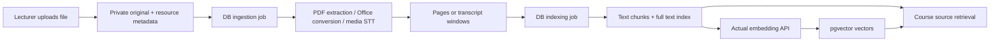
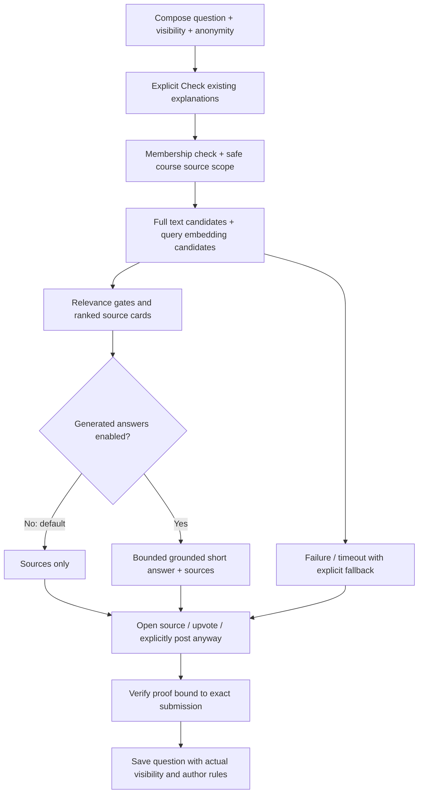

# AI workflow — implementation for owner review

**Status: review copy, 2026-10-20.** This describes what the code currently does. The review spaces below are intentionally blank; describing a default here does not mean the owner has approved it. The accompanying UX fixes change navigation, source links and excerpt formatting, not AI prompts, models, ranking, chunking or automatic decisions.

LectureLoop centres human questions and teaching. AI assists discovery, transcription and lecturer organisation. There is no chatbot, conversation memory, student profiling or autonomous question resolution.

## 1. Map of AI use

| Feature | Trigger | AI input | Output and consequence | User control |
| --- | --- | --- | --- | --- |
| Resource embeddings | Upload finishes, or lecturer rebuilds index | Extracted document text or imported transcript chunks | Search vectors in Postgres; source remains the original file | Exclude resource from search; retry indexing |
| Course search / question preflight | Search submit; required check before question/note submission | Search/question text sent for embedding | Ranked permitted sources and public questions; nothing posted automatically | Open sources, upvote an existing question, retry, or explicitly post anyway |
| Optional generated answer | Question preflight, only when course setting enabled | Question and retrieved source excerpts/metadata | Short generated prose, shown separately from original sources | **Disabled by default**; course lecturer enables it |
| Live transcription | Lecturer starts microphone | PCM microphone stream, lecture title as vocabulary context | Captions, retained transcript windows, searchable lecture text | Explicit microphone permission, pause/stop; optional caption panel |
| Imported media transcription | MP3/MP4 processing | Converted 30-second WAV windows | Retained transcript and timestamped search sources | Retry processing; exclude resource from search |
| Teaching outline | Lecturer requests outline | Selected deck text | Optional list of topics for lecturer and topic context | Explicit request; not required to start teaching |
| Topic/checkpoint inference | Slide change or finalized speech enqueues job | Slide, recent speech, material extracts, optional outline, previous topic | Lecturer topic state; potentially opens/suggests poll under policy | Manual/suggested/auto/end-only policy; pause context; manual polls remain usable |
| Question equivalence grouping | New question or converted feedback | Question text and same-course/session candidates | Private lecturer grouping; no student cluster/count display | Lecturer can group, merge, split and resolve |
| Feedback classification/rewrite | Student explicitly sends anonymous poll note | Original note | Feedback or private anonymous question; lightly rewritten display text | Original retained; lecturer can route note manually |
| Recording excerpt selection | Ended lecture, resolution, recording assembly or late transcript | Question and actual transcript candidates | Suggested playable passage, or unavailable state | Lecturer can correct/remove link; marked answered stays answered |

**Code entry points:** [question routes](../apps/api/app/questions.py), [retrieval](../apps/api/app/ai/retrieval.py), [intelligence](../apps/api/app/intelligence.py), [audio](../apps/api/app/audio.py), [ingestion](../apps/api/app/ingest.py), [worker](../apps/api/app/worker.py).

## 2. Provider boundary and information leaving the VM

All calls originate on the API/worker server. Browser code receives application results, never the OpenAI key. Provider protocols live in [contracts.py](../apps/api/app/ai/providers/contracts.py); the actual implementations are [openai.py](../apps/api/app/ai/providers/openai.py). Call sites instantiate the OpenAI adapters directly; replacing a provider currently requires wiring another implementation into those call sites, not just changing a dropdown.

| Environment setting | Code default | Interface used |
| --- | --- | --- |
| `OPENAI_TEXT_MODEL` | `gpt-4.1-mini` | Responses API, strict JSON schema, Pydantic validation |
| `OPENAI_EMBED_MODEL` | `text-embedding-3-small` | Embeddings API |
| `OPENAI_EMBED_DIMENSIONS` | `1536` | Vector dimensions checked against DB configuration |
| `OPENAI_LIVE_STT_MODEL` | `gpt-live-transcribe` | Server WebSocket transcription session, PCM 24 kHz |
| `OPENAI_BATCH_STT_MODEL` | `gpt-transcribe` | File transcription endpoint, returned text |
| `OPENAI_BASE_URL` | `https://api.openai.com/v1` | Configurable server endpoint |

These are code defaults, not a claim that every model is available to every account. Existing provider verification is recorded in `PROGRESS.md`; this UX change does not alter those integrations.

What leaves the server is the relevant text/audio listed in section 1. That includes private question text for lecturer-only equivalence and excerpt matching, and anonymous feedback text for classification. Anonymous means no saved question-author identity; it does **not** mean question content is never sent to the provider. Provider payloads do not intentionally include student account IDs or email addresses, but user-authored text can itself contain personal information. Retrieved source metadata may include internal source/course URLs and IDs.

The shared text adapter instructs the model to treat quoted course content as data, never instructions, and restricts output to a JSON schema. Prompt text is capped at 50,000 characters. This is a mitigation, not proof that model judgments are correct. There is no separate safety/reranker model or vision analysis.

Local storage and provider retention are different: the application stores the outputs described below, but does not maintain a separate local raw-provider-response history. The Responses request currently does **not** explicitly set `store: false`; provider-side storage/retention is not controlled by a local course deletion or the media volume. Account/provider retention policy and whether to change that request setting remain review topics; no new retention change is made in this UX patch.

**Owner review — provider and data flow**

| Workflow changes | Storage / provider preferences | What users should see |
| --- | --- | --- |
|  |  |  |
|  |  |  |

Decision / follow-up notes:

> 

## 3. PDF, PowerPoint and other resource ingestion

1. The server checks lecturer membership, file extension/content, size and folder course. Original bytes go into the persistent private media volume. A `Resource` row and queued `Job` are committed before conversion.
2. PDF extraction uses **PyMuPDF, not an LLM**. Each page produces `page.get_text()` plus a rendered PNG at scale 1.3. PPT/PPTX and DOC/DOCX are converted to PDF using LibreOffice, then use the same page pipeline. Animations are not retained. Up to 500 pages are rendered.
3. TXT is read as UTF-8. JSON is parsed and pretty-printed as text; there is currently **no schema-aware Q&A import** that turns JSON entries into forum questions. TXT/JSON is split into 6,000-character pseudo-pages.
4. `Resource.pages` JSON in Postgres stores page text and private PNG storage references, or media transcript windows. Originals, converted PDFs, PNGs and audio files remain on the media volume.
5. The indexing job deletes old chunks for that resource and builds chunks from each page/window: take up to **2,200 characters every 1,800 characters**, nominally 400 characters overlap. There is no semantic paragraph-aware splitter. Page number or audio input-window offsets become citation metadata.
6. `SourceChunk` stores **readable source text as well as the vector**. The vector is not a human-readable reformatted document and does not replace the source. Embedding batches contain up to 32 chunks. Full-text retrieval can use the saved text without embeddings. Vectors are stored only after a real embedding response; model/dimension mismatch is rejected.
7. Conversion status and index-job status are separate. An index job can finish without embeddings when no key is configured: “ready” describes completion of that job, not proof that semantic vectors exist for every chunk. An embedding failure after text chunks were committed can still leave keyword-searchable text and partial embedding progress. No vectors are fabricated.

### What the user sees now

Resources have a filename, file kind/size, actual processing state and separate search state. Lecturer management opens in a dialog. PDF/converted Office sources open in an authenticated PDF.js viewer with page navigation and zoom; a page-image mode is available if rendering fails. No browser PDF plugin is required. The optional “Read page text” disclosure extracts that displayed page directly with PDF.js; it does not rewrite the stored retrieval text or invoke AI. Explicit “Download original” remains available. Citation page numbers open that page. Documents have **no fabricated audio timestamp**.

Search cards show source type, filename, page or real audio range, and a plain-text **Source excerpt**. Display formatting collapses layout whitespace, shows roughly 420 characters initially, and lets the user expand the returned excerpt. This does not rewrite the stored text. The API currently returns the **first 1,000 characters of the selected chunk**, not a query-centred passage or the whole page. “Read full excerpt” expands that returned extract; the original page is available via Open source.

### Current limitations for review

- PDF reading order, columns, tables, formulas, headers and hyphenated line breaks depend on raw extraction. Whitespace formatting cannot reconstruct the original document layout.
- There is no OCR, image understanding, table parser, automatic heading hierarchy, content deduplication or AI cleanup of extracted PDF text. Scanned/image-only PDFs can render correctly while contributing little searchable text.
- Chunks can split a sentence or formula; overlaps can produce neighbouring results from the same page. There is no cross-result deduplication/reranking pass. TXT/JSON pseudo-page numbers reflect implementation chunks rather than actual printed pages.
- No AI-generated description is substituted for extracted text. A matched resource is labelled material, not a verified answer to the exact question.
- Renaming a resource does not itself refresh already-indexed chunk titles; a rebuild updates them. Exclusion is enforced immediately at retrieval time even while cleanup/reindexing is pending.

**Owner review — extraction → chunks → storage → result display**

| Step | Keep / change | Proposed workflow | Storage expectation | Desired user presentation |
| --- | --- | --- | --- | --- |
| Extraction / OCR / layout |  |  |  |  |
| Chunk size / boundaries / overlap |  |  |  |  |
| Indexed text and vectors |  |  |  |  |
| Snippet selection / duplicate results |  |  |  |  |
| Source preview / page navigation |  |  |  |  |

Decision / follow-up notes:

> 

## 4. Search, required preflight and optional generated answers

**Search mechanics.** Postgres returns up to 50 full-text candidates (`websearch_to_tsquery`, English). A query embedding has a 3-second timeout and returns up to 30 cosine-nearest chunks in the configured embedding space. Sources are filtered by current course, membership, resource inclusion/readiness, public question state and answer visibility. Public questions are also checked before their index job finishes.

Candidates pass if lexical overlap score is at least 0.45 with two shared significant words, **or** vector similarity is at least 0.78. Ranking is `0.60 × lexical + 0.35 × nonnegative similarity + 0.05 × capped full-text rank`; return at most eight. The public-question fallback uses a lexical threshold of 0.6. Scores are engineering heuristics, **not calibrated probabilities or evidence that a question is answered**. There is no LLM reranker on ordinary retrieval. Search and preflight use the same retrieval function; the course Search page does not generate an answer.

**Preflight interaction.** Retrieval has a 5-second bound. A semantic error can still return genuine keyword matches with a warning. Optional generation has a separate 3-second bound. Editing the question, visibility or anonymity clears the browser's previous results/proof. Preflight returns a signed, expiring token containing a hash of course, exact text, session and submission options, plus failure status. It contains no raw question or user ID, is not a durable preflight row, and expires after ten minutes. Posting validates it server-side. A provider failure still gives an explicit posting path; the UI never silently posts when search completes. If the preflight HTTP request itself failed, “post anyway” retries preflight to obtain a valid proof before submitting.

**Generated answer, if enabled.** The model gets the question plus the returned source excerpts/metadata and must return `{answer, source_ids}`. Unknown or absent citation IDs cause the answer to be discarded. The saved display response is capped at 1,500 characters. Only the answer string and the separate source cards are returned to the browser: there is currently no sentence-by-sentence citation map. The app does not separately persist the generated answer or query history. Schema and ID validation do not independently prove every claim is supported. This feature remains **OFF by default**.

**Visibility.** Private questions and private written replies never become student suggestions, public events or public RAG sources, including when a lecturer does the search. Public lecture speech is a separate general course source: it can be retrieved without linking to the private question that prompted it. Lecturer-written answers, student public replies and public question text have different source labels; a public reply is not automatically endorsed as lecturer teaching.

**Owner review — retrieval and pre-submission interaction**

| Workflow / relevance changes | What may be saved | What the student should see before posting |
| --- | --- | --- |
|  |  |  |
|  |  |  |

**Owner review — optional generation**

| Enablement / allowed uses | Citation and storage expectations | Presentation / fallback |
| --- | --- | --- |
|  |  |  |

Decision / follow-up notes:

> 

## 5. Live and imported audio

**Live:** the [browser capture layer](../apps/web/src/AudioCapture.tsx) uses an abstract `AudioSource`, with a microphone implementation. AudioWorklet PCM16 mono is resampled to 24 kHz and forwarded to the authenticated lecturer audio WebSocket. The server owns the provider connection. The lecture title is the transcription prompt; course documents/private question queues are not added to that live STT prompt. Deterministic approximately five-second input commits are used; no server VAD is assumed.

Committed provider item IDs are mapped to checked input-window offsets on the session timeline. Partial and final caption events propagate to authorized course clients. Final text and item/window metadata are stored in `Transcript`; partial deltas are also persisted in `SessionEvent` by the event mechanism, so “partial” does not mean memory-only. No precise word timings are inferred. Final segments enqueue session indexing and topic inference. Captions are an optional student panel; the archived transcript is searchable.

Compressed recording uses a parallel MediaRecorder path with small checksummed durable uploads, separate capture groups, and saved start/end offsets. When recording was enabled with consent, FFmpeg assembles playable audio and aligns it with slide/annotation events. Microphone transcription can operate when recording retention is off; transcripts and caption events are still retained. A transcript-only search result must not imply captured audio exists. The current source-card label distinguishes lecture transcripts from recorded lecture sources.

**Imported MP3/MP4:** FFmpeg strips video for analysis and produces mono 24 kHz WAV windows of about 30 seconds. Batch STT returns text; `Transcript` stores measured input-window offsets and `timing=input_window`. The original remains the playback source. No original slide alignment is assumed. Analysis WAV files remain in private storage; no automatic cleanup policy currently removes them.

**Failures:** microphone/provider failure is visible; slides, questions and manual polls remain operational. Missing recording has no pretend playback. Live recording assembly does not automatically run batch STT to repair a failed live transcript. Imported-file retries can reuse already saved transcript windows. These are separate workflows, not an implemented universal transcription repair pipeline.

**Owner review — transcription, recording and replay**

| Trigger / consent changes | Audio / transcript / caption retention | What students and lecturers should see |
| --- | --- | --- |
|  |  |  |
|  |  |  |

Decision / follow-up notes:

> 

## 6. Outline, topics and automatic polls

An explicit lecturer outline request enqueues `generate_outline`. It sends up to 30,000 characters of serialized selected-deck page text to the text adapter and saves `{topics: [...]}` in `Lecture.outline_json`. No generated outline is necessary to create/start the lecture.

A slide change or finalized transcript enqueues `infer_topic`. The job skips ended/paused sessions and inference less than 20 seconds after the previous inference. Context is the current slide (up to 6,000 characters), the last twelve finalized speech windows, up to four material extracts (1,000 characters each, selected by lexical overlap from up to thirty ready/included resources), the optional outline and previous topic name. This is a bounded lexical context collection, not a separate vector RAG call.

The model returns topic, subtopic, transition, checkpoint and brief reason. `LiveSession.topic_json` stores current state, timestamps and suggestion/error flags; it overwrites current topic state rather than building a full historical topic table. Events announce updates only to lecturers. The UI does not show a topic confidence percentage.

For `auto`, the code requires an established previous topic, a different inferred topic, a completed-explanation checkpoint and cooldown since start/transition/poll (default 180 seconds). `suggested` exposes a checkpoint flag. `manual` does not open topic polls. Current `end-only` means a detected checkpoint on the **last slide**, once, rather than an unconditional end-session poll. Course poll settings are copied at session start. A new poll supersedes the previous one, while the database enforces at most one open poll. Lecturer manual controls do not depend on successful inference.

**Owner review — context and polling**

| Context / checkpoint rules | Saved state / history | Lecturer and student interaction |
| --- | --- | --- |
|  |  |  |
|  |  |  |

Decision / follow-up notes:

> 

## 7. Feedback transformation and question grouping

**Feedback:** the student writes an anonymous lecturer-only poll note, checks sources, then explicitly sends it. The original is stored in `Feedback.text_original` without a student author link. A background text call returns `question` or `feedback` and a soft rewrite. The rewritten text, classification and `ai_modified` flag are saved alongside the original. If classified as a question, a **private anonymous** `Question` is created automatically after that explicit note submission, using original and display text separately. No public publication occurs. The lecturer sees classification, “AI edited” when applicable and original text; can manually route unclassified/feedback notes to the private question queue. Failed classification leaves the original available.

**Grouping:** for a new open question, take up to eighty recent open questions from the same course **and same session** (or course forum context). Embed those texts, consider the top three with cosine similarity at least 0.70, then ask whether the exact same answer would satisfy both questions. Store a `Cluster` and question cluster assignments; the canonical text is an existing candidate question, not an invented teaching answer. These comparison embeddings are transient call results, separate from persistent retrieval vectors. Manually maintained clusters are not overwritten by automatic grouping.

Private and public questions may be compared only within the lecturer domain. Students see ordinary visibility-filtered questions, never mixed cluster metadata/counts. Lecturer resolve-group marks underlying questions answered immediately and queues matching separately. Grouping failure does not prevent posting or manual organisation.

**Owner review — transformations and organisation**

| Feature | Workflow changes | Original / derived storage | Desired lecturer / student display |
| --- | --- | --- | --- |
| Feedback classification |  |  |  |
| Soft rewriting |  |  |  |
| Automatic grouping |  |  |  |
| Manual override / resolution |  |  |  |

Decision / follow-up notes:

> 

## 8. Suggested recording excerpts and human resolution

Marking a question/group answered is an immediate human state change. There is no start-answer/stop-answer control. An excerpt job runs against an ended session, waits for recording readiness and leaves the question's resolution unchanged throughout.

The current candidate selector is **lexical**, not hybrid/vector: rank transcript segments, keep up to eight with score at least 0.25 and two shared significant words, then append up to two contiguous following windows (gap at most 1.5 seconds, total span at most 45 seconds). Send the actual windows plus original question to the text model. It returns an existing source ID or null plus an addresses-question judgment. Only IDs in those candidates are accepted. Saved excerpt text and timestamps are taken from the actual transcript, never invented by that model.

`Question.match_json` stores pending/ready/unavailable/removed, source ID, excerpt, real input-window bounds, replay URL and a `possibly_addressed` flag. Unmarked questions with candidate explanations remain open; those suggestions are lecturer-only. For answered public questions a suggested excerpt can be visible to learners. Private question/match metadata remains lecturer-only, while the general recorded teaching transcript can independently be course-retrievable.

Lecturers can remove a match (a removal is rechecked before background jobs save results) or correct it to a range inside an existing transcript segment. No match/no recording/provider failure does not undo “answered”. The selection reason returned by the model is not stored as a separate review history. Input-window timing still limits excerpt precision; word-level alignment is not implemented.

**Owner review — explanation reuse**

| Selection / verification workflow | Saved associations / correction history | Labels and playback interaction |
| --- | --- | --- |
|  |  |  |
|  |  |  |

Decision / follow-up notes:

> 

## 9. Storage, deletion and failure summary

| Location | Saved information | Access / lifetime |
| --- | --- | --- |
| Private media volume | Originals, converted PDFs, page PNGs, analysis WAVs, recording chunks, assembled audio, signing key | Authenticated course endpoints; persistent across Compose restarts; file garbage collection is not automatic |
| `Resource.pages` | Extracted page text/image paths or imported transcript windows | Course-scoped backend use; browser metadata does not expose raw storage paths |
| `SourceChunk` + embedding configuration | Search text, vectors/model, course/source IDs, page/time locators | Public-safe retrieval scope checked against current source metadata |
| `Transcript`, `Recording`, `AudioChunk`, slide/annotation events | Final speech text, timing, protected playback and replay mapping | Course membership; recording retention governed by session consent; transcripts can exist without recording |
| `Question`, `Answer`, `Feedback`, `Cluster` | Original/display wording, visibility, human state, rewrite flags, grouping, suggested match | Private/mixed material lecturer-only; anonymous question author ID NULL |
| `Lecture.outline_json`, `LiveSession.topic_json` | Optional outline and current topic/checkpoint state | Lecturer-facing; no complete topic revision history |
| `Job`, `SessionEvent` | Processing attempts/status/errors; durable event payloads including caption deltas/finals | Postgres; public event sequences exclude private activity; no automatic retention pruning |
| Browser memory | Current query, preflight cards/proof, transient generated answer and named-private submission receipt | Not a saved query/conversation history; in-memory state can be lost on refresh/navigation |
| Provider service | Request inputs and provider-managed response data | Outside local backups/deletion; see provider-retention review in section 2 |

A single Postgres-backed worker claims jobs with leases, renews them every 30 seconds and retries up to three times. Provider calls can take longer in background jobs than preflight's bounds. Failed jobs expose real errors; manual teaching remains available. Removing/excluding content takes effect in authorization/retrieval before any eventual cleanup. Course deletion removes database records, but orphaned media may remain inaccessible in private storage; neither that action nor question deletion promises provider-side erasure. Backups retain snapshots until the operator removes them.

**Owner review — storage and lifecycle**

| Data category | Required retention / deletion | Review history needed? | User-facing explanation |
| --- | --- | --- | --- |
| Original files / extracted text / vectors |  |  |  |
| Audio / transcripts / caption events |  |  |  |
| Questions / feedback / derived groups |  |  |  |
| Generated outputs / provider requests |  |  |  |
| Jobs / events / backups |  |  |  |

## Review handoff

Suggested order: review section 3 for the PDF experience, section 4 for relevance/preflight, then the remaining automatic workflows and retention. Leave comments in the spaces above or reference a section number in chat. The implementation should change only after those requested changes are clear; the spaces are not outstanding questions blocking the current UX fixes.

**Owner decisions to implement next:**

1. 
2. 
3. 

**Approved unchanged:**

- 

**Deferred:**

- 
